# Ingeniería inversa · Hevy (`hevyapp.com`)

> Historia H1.1. Estudia el sitio con las DevTools del navegador (F12) y documenta al menos
> 10 hallazgos con capturas. Guarda las capturas en `docs/img/`.
>
> Reglas: se recrea la experiencia, no la marca. No descargues sus archivos; no recrees
> pantallas de inicio de sesión ni de pago.

## 1. Estructura (pestaña Elements)

- **Etiquetas semánticas:** Utiliza `<h1>` para el titular principal y `<a>` para botones de llamada a la acción, pero abusa de contenedores `
` anidados generados automáticamente por **WordPress + Elementor** (`div.elementor-element`, `div.elementor-widget-container`). Faltan etiquetas semánticas claras como `<main>`, `<nav>` o `<article>` en el flujo principal.
- **Layout:** Combina bloques de flujo estándar (`display: block`) con contenedores **Flexbox** (`display: flex`) dentro de los botones y encabezados, además de clases de visibilidad responsiva propias del maquetador (`elementor-hidden-desktop`).

## 2. Sistema de diseño (pestaña Elements → Computed)

| Elemento | Valor |
| --- | --- |
| Color principal | `rgb(38, 127, 232)` (`#267FE8`) |
| Color de fondo | `rgb(255, 255, 255)` (`#FFFFFF`) |
| Tipografía de títulos | `Inter, sans-serif` (`64px`, peso `600`, `line-height: 70.4px`) |
| Tipografía de texto | `Inter, sans-serif` (cargada en formato `woff2` con `font-display: swap`) |
| Tamaño base del texto | `16px` (títulos principales en `64px`) |
| Espaciado típico | `12px 20px` en botones principales |
| Radio de bordes | `12px` en botones principales |

## 3. Red (pestaña Network → Fetch/XHR)

- **Peticiones al cargar:** Realiza **132 solicitudes** en total al cargar la página inicial, de las cuales 8 son `Fetch/XHR`.
- **Formato de datos:** Al ser un sitio promocional sobre WordPress, no consume una API de rutinas o ejercicios en esta vista. Las peticiones XHR activas corresponden principalmente a telemetría y analítica de **Google Analytics 4** (`collect?v=2&tid=G-...`) y registros (`log?format=json`).
- **Comportamiento al filtrar/navegar:** La navegación entre secciones informativas dispara cargas de recursos estáticos y scripts de seguimiento, sin filtrado dinámico de datos en memoria.

## 4. Estado (pestaña Application)

- **URL:** En los botones de descarga utiliza parámetros de atribución y redirección dinámica (`?adj_t=...&adj_deep_link=...`) para enviar al usuario a la tienda correspondiente (App Store / Google Play).
- **Cookies:** Guarda múltiples cookies de analítica (**Google Analytics**: `_ga`, `_ga_48...`, `_ga_J3...`), consentimiento GDPR mediante el plugin **Complianz** (`cmplz_... = dismissed`) y cookies de terceros de Google (`AEC`, `NID`, `__Secure-...`).
- **Local Storage:** Solo guarda la clave `elementor` con el objeto `{"__expiration":{},"pageViews":5,"sessions":3}` para conteo interno de vistas del maquetador, sin persistir estado de entrenamientos ni rutinas.

## 5. Rendimiento y accesibilidad (pestaña Lighthouse)

| Métrica | Sitio original | Mi versión |
| --- | --- | --- |
| Rendimiento | 42 | **89** |
| Accesibilidad | 91 | **100** |
| Buenas prácticas | 77 | **92** |

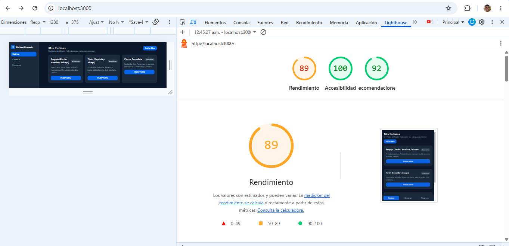
## 6. Hallazgos

| # | Hallazgo | Captura |
| --- | --- | --- |
| 1 | El sitio está construido sobre **WordPress + Elementor** (`wp-singular`, `elementor-page`), generando un árbol DOM muy profundo con exceso de `
` (*div soup*). | 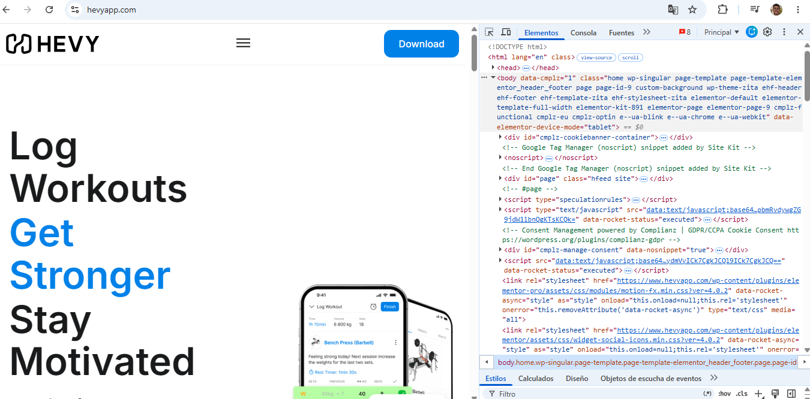 |
| 2 | Utiliza la fuente **`Inter`** servida en formato moderno `woff2` con `font-display: swap` para evitar texto invisible durante la carga. | 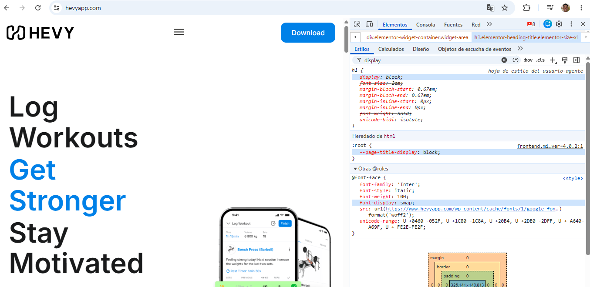 |
| 3 | El titular principal (`h1`) tiene un tamaño agresivo de `64px`, peso `600`, `line-height: 70.4px` y color `rgb(25, 26, 27)`, además de usar clases de ocultamiento (`elementor-hidden-desktop`). | 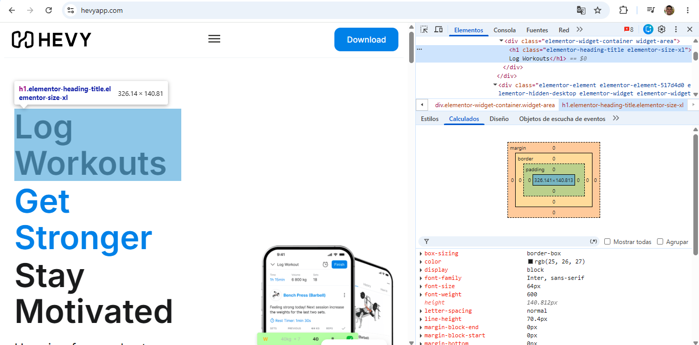 |
| 4 | Los botones principales usan azul `#267FE8`, texto blanco, `border-radius: 12px`, `padding: 12px 20px` y alineación interna con `flex`. | 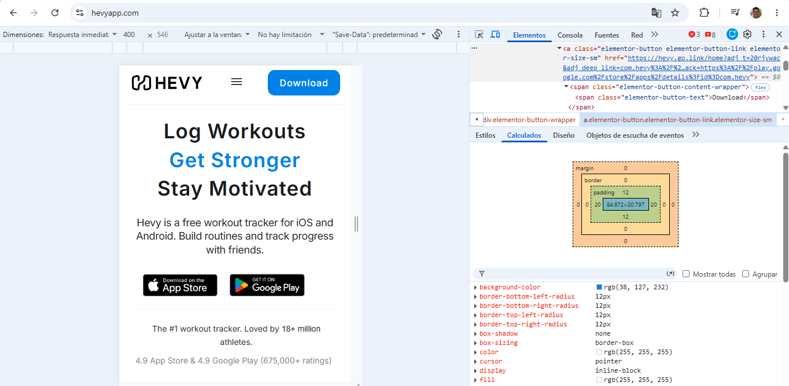 |
| 5 | La carga inicial dispara **132 solicitudes HTTP**, sobrecargando la red con hojas de estilo y scripts de plugins de terceros. | 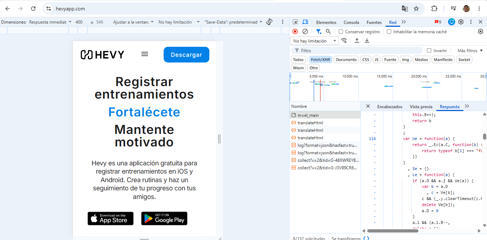 |
| 6 | Almacena gran cantidad de cookies de seguimiento (GA4 y cookies de terceros de Google) y requiere un gestor de consentimiento GDPR (`Complianz`). | 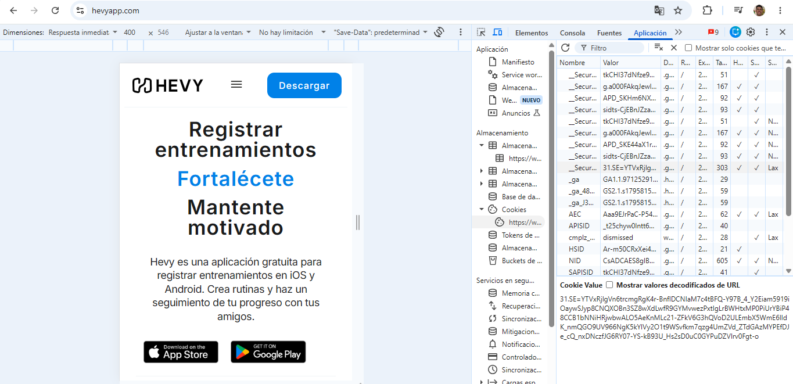 |
| 7 | Obtiene un **Rendimiento muy bajo en Lighthouse (42/100)** y **Buenas prácticas de 77/100**, aunque mantiene buena Accesibilidad (91/100). | 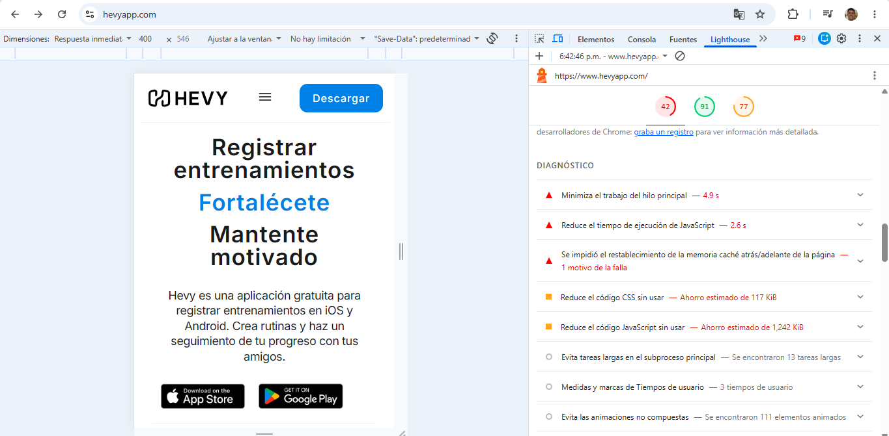 |
| 8 | La pestaña **Problemas/Consola** reporta **9 problemas activos**: un bloqueo de seguridad CSP por uso de `eval` en JavaScript (`script-src`) y **8 problemas de accesibilidad** por elementos interactivos dentro de etiquetas `
`, además de alertas de `WPRocket` y `jquery-migrate 3.4.1`. | 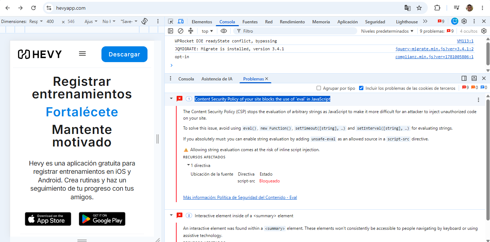 |
| 9 | Los diagnósticos de **Lighthouse** revelan **4.9 s** de trabajo en el hilo principal, **2.6 s** de ejecución de JS, **1,242 KiB de JavaScript sin usar**, **117 KiB de CSS sin usar**, 13 tareas largas y 111 animaciones no compuestas. | 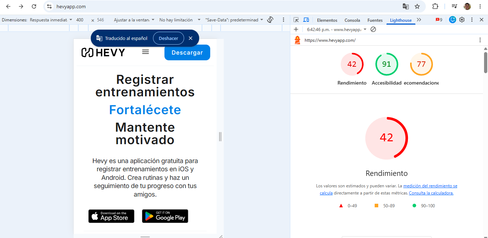 |
| 10 | En **Local Storage** solo guarda la clave `elementor` (`{"__expiration":{},"pageViews":5,"sessions":3}`) para conteo de vistas del maquetador, sin persistir ningún estado de entrenamientos o rutinas. | 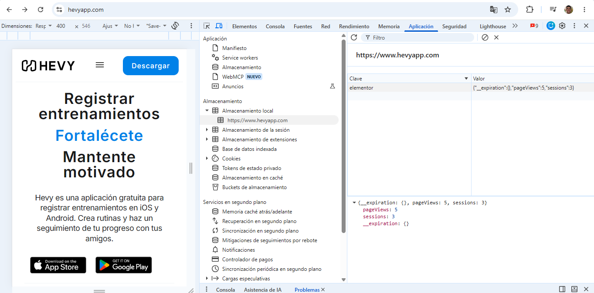 |

## 7. Tres mejoras que hice en mi versión (H1.3)

1. **HTML semántico y cero dependencias pesadas (+47 en Rendimiento):** Se eliminó el exceso de `
` (*div soup*) de WordPress/Elementor y los 1,242 KiB de JS sin usar, construyendo las 3 vistas en HTML/CSS/JS puro con gráficos en `<svg>` nativo.
2. **Accesibilidad perfecta (100/100):** Se corrigieron los problemas de estructura semántica (`<main>`, `<aside>`, `<nav>`, `<section>`, `<article>`), etiquetas `aria-*` en controles interactivos y contraste de color sobre fondo pizarra (`#0F172A`).
3. **Buenas prácticas y privacidad (+15 puntos):** Se eliminaron las cookies de rastreo de terceros (GA4/Google), el gestor GDPR y el bloqueo de seguridad CSP por uso de `eval`, entregando una interfaz interactiva funcional desde la primera carga con temporizador basado en `Date.now()` y vibración háptica (`navigator.vibrate()`).